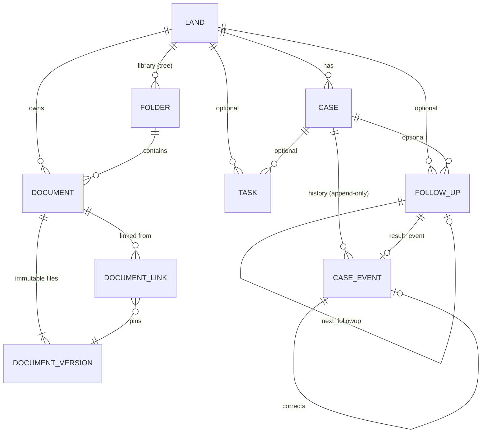

# Domain model

Schemas: `sijil/sijil/doctype/<name>/<name>.json` (authoritative). This page explains meaning and relations.

## Entities
| DocType | Name | Purpose | Key fields |
|---|---|---|---|
| **Sijil Land** | `LAND-#####` | Land / project | `land_name`, `land_code`, `status` (Active/On Hold/Completed/Archived), `city`, `location`, `company`→Company, `project`→Project, `responsibles` (child: user, responsibility), `organizations` (child: organization, role), `root_folder` |
| **Sijil Case** | `CASE-#####` | A long-running transaction on a land | `title`, `reference_no`, `land`, `case_type`, `status`, `priority`, `owner_user`, `current_situation` + `situation_updated_on`, `external_organization`, `external_contact`→Contact, `start_date`, `target_date`, derived `last_update_date`, `next_followup_date`, `relations` (child), `project` (read-only) |
| **Sijil Case Event** | `EVT-#######` | A development that happened | `case`, `land` (derived), `event_date`, `event_time`, `event_type`, `communication_method`, `is_milestone`, `title`, `description` (rich text), `external_organization`, `outcome`, `situation_update`, `status_after`, `recorded_by`, `recorded_on`, `source_followup`, `entry_status` (Active/Superseded), `corrects`, `superseded_by`, `correction_reason` |
| **Sijil Follow Up** | `FUP-#####` | Something that must be checked | `title`, `description`, `case`, `land`, `originating_event`, `assigned_to`, `due_date`, `priority`, `status` (Open/Completed/Cancelled), `reminder_days_before`, `completion_date`, `outcome`, `result_event`, `next_followup`, `todo`, `calendar_event`, `last_reminder_on` |
| **Sijil Task** | `STK-#####` | Ordinary work | `title`, `description`, `land`, `case`, `case_event`, `status` (Open/In Progress/Completed/Cancelled), `priority`, `assigned_to`, `start_date`, `due_date`, `completed_on`, `completion_notes`, `updates` (child log), `project`, `erpnext_task`, `todo` |
| **Sijil Folder** | `FLD-#######` | Library folder | `folder_name`, `land`, `parent_folder`, `is_root`, `folder_path` (materialized, `/FLD-1/FLD-2/`) |
| **Sijil Document** | `DOC-#######` | Logical document | `title`, `land`, `folder`, `document_type`, `reference_no`, `document_date`, `description`, `is_confidential`, `archived`, `current_version`, `version_count` |
| **Sijil Document Version** | `DVER-#######` | One stored file (immutable) | `document`, `version_no`, `file` (private File URL), `file_name`, `file_size`, `is_current`, `notes`, `uploaded_by` |
| **Sijil Document Link** | hash | Document ↔ record | `document`, `document_version` (pinned), `follow_latest`, `linked_doctype` (Land/Case/Case Event/Task/Follow Up), `linked_name`, `land` (derived), `note`, `linked_by` |
| **Sijil External Organization** | its name | Consultant, municipality, … | `organization_name`, `organization_type`, `phone`, `email`, `contact`→Contact, `supplier`→Supplier, `customer`→Customer, `address`, `disabled` |
| **Sijil Case Type** | its name | Case category | `type_name`, `description` |
| **Sijil Settings** | single | Configuration | `default_company`, `stale_case_days`, `default_reminder_days`, `restrict_to_assigned_lands`, integration flags, `folder_templates` (child: path) |

Child tables: Sijil Land Responsible, Sijil Land Organization, Sijil Case Relation, Sijil Task Update,
Sijil Folder Template.

## Derived vs stored
| Value | How |
|---|---|
| Follow-up Upcoming / Due Today / Overdue | Computed from `status` + `due_date` (`utils.followup_state`), never stored |
| `Case.last_update_date` | Max active event date, set by the event controller |
| `Case.current_situation`, `Case.status` | Set directly on create/edit, or by the **latest** event's `situation_update` / `status_after` |
| `Case.next_followup_date` | Min due date of open follow-ups (`utils.refresh_case_followup_date`) |
| `*.land` on events, links, follow-ups | Copied from the parent case/record for fast land-scoped queries and permissions |
| `Document.current_version`, `version_count` | Maintained by the version controller |
| Task `overdue` flag | Computed in the API |

## Lifecycle and deletion
Nothing that is part of history is hard-deleted: events and versions never; cases with events, completed
follow-ups with a result event, linked documents and non-empty lands/folders are blocked. Archive/cancel
instead. Archiving a land currently only blocks new cases ([OD-9](../product/open-decisions.md)).
